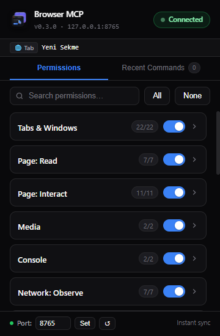
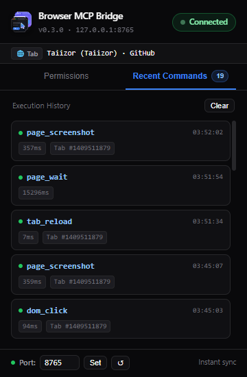

# Browser MCP — Full-Authority Browser Bridge (Chromium)

[](https://github.com/Taiizor/browser-mcp/actions/workflows/ci.yml)
[](LICENSE)
[](https://bun.sh)
[](extension/)
[](https://microsoftedge.microsoft.com/addons/detail/hdhibkihdkndmfecegdnbpebolhokkbh)

MCP server (`stdio`) + Chrome/Edge extension (`WebSocket`) with access to everything
in the browser: clicking, typing, search, tab & window management, tab groups, network intercept/throttle,
console, cookies, storage, offscreen clipboard & tab audio recording, desktop notifications, session restore, screenshots, PDF, and CDP.

## Architecture

```text
AI (OpenCode / Claude / Gemini / Any MCP Client)
  │  stdio (MCP Tools, Resources, Prompts)
  ▼
mcp-server/ (Bun; the first process owns the WS bridge on 127.0.0.1:<port>,
  │          later processes join it as token-authenticated satellites)
  │  ws://127.0.0.1:8765 (configurable via CLI flag or env var)
  │  protocol v2: trusted extension id (Origin) + hello/welcome handshake
  ▼
extension/ (Chrome MV3, WS client with alarms heartbeat)
  ├── background.js → command router & permission gate, tabs/windows/tab groups, cookies, history,
  │                   webRequest capture, debugger/CDP (js_evaluate, trusted input, screenshots, PDF,
  │                   mocking, throttling), console/dialog hooks on agent tabs, browsing data, notifications
  ├── offscreen.js  → clipboard read/write & tab audio capture (MediaRecorder, chunked transfer)
  ├── content.js    → DOM snapshot & refs, selectors, click/type/fill, DOM side of page_wait,
  │                   storage & IndexedDB, console/dialog relay from the page hooks
  └── popup.js      → permission switches, audit log, port, pairing status
```

## Quick Start

### 1. MCP server

Requirements: [Bun](https://bun.sh) >= 1.1.

```powershell
cd mcp-server
bun install
# Run server (default port 8765):
bun run src/index.ts
# Or with a custom port:
bun run src/index.ts --port 9000
```

### 2. Extension (Chrome / Edge)

Requires a Chromium browser version 116 or newer (Chrome, Edge, Brave, Opera).
Install from the [Edge Add-ons store](https://microsoftedge.microsoft.com/addons/detail/hdhibkihdkndmfecegdnbpebolhokkbh),
or load unpacked for development:

1. `chrome://extensions` → enable **Developer Mode**.
2. **Load unpacked** → select the `extension/` folder.
3. Click the **Browser MCP** toolbar icon → you should see `Connected`.
   On a fresh install the first extension that connects is paired with the server
   automatically; if the popup shows `Rejected`, see [Pairing & Trust](#pairing--trust).
4. Configure or switch ports instantly in the popup footer if needed.

### 3. MCP Client Configuration

The server runs over `stdio`, so any MCP-compatible client works. Use an **absolute path**
to `mcp-server/src/index.ts` and make sure `bun` is on your `PATH`.
(On Windows, use forward slashes or escaped backslashes in JSON.)
> **PATH tip:** GUI-launched clients (Claude Desktop, Cursor, Windsurf…) may not inherit
> your shell `PATH`. If the server fails to start, put the full path to `bun` in `command`
> (find it with `where bun` on Windows / `which bun` on macOS-Linux).

| Client | Config file |
|---|---|
| OpenCode | `opencode.json` |
| Claude Code | `.mcp.json` (project) or `claude mcp add` CLI |
| Claude Desktop | `claude_desktop_config.json` |
| Cursor | `.cursor/mcp.json` (project) or `~/.cursor/mcp.json` (global) |
| Windsurf | `~/.config/devin/mcp_config.json` (see note below) |
| VS Code (Copilot) | `.mcp.json` at workspace root (portable format) |
| Gemini CLI | `~/.gemini/settings.json` (global) or `.gemini/settings.json` (project), or `gemini mcp add` CLI |
| Antigravity | `~/.gemini/config/mcp_config.json` (global) or `.agents/mcp_config.json` (workspace) |

**OpenCode v2** (`opencode.json` / `opencode.jsonc`) — via CLI (recommended):

```powershell
opencode mcp add browser -- bun run <path-to-repo>/mcp-server/src/index.ts
```

or by hand:

```json
{
  "$schema": "https://opencode.ai/config.json",
  "mcp": {
    "servers": {
      "browser": {
        "type": "local",
        "command": ["bun", "run", "<path-to-repo>/mcp-server/src/index.ts"],
        "environment": {
          "BROWSER_MCP_PORT": "8765"
        }
      }
    }
  }
}
```

`environment` is optional — omit it to use the default port (`8765`). See [Custom Port Selection](#custom-port-selection).
Verify with `opencode mcp list` (should show `browser connected`).
Note: OpenCode v1 nests servers directly under `mcp` without the `servers` key.

**Claude Code** — via CLI (recommended):

```powershell
claude mcp add browser -- bun run <path-to-repo>/mcp-server/src/index.ts
```

(Add `--scope project` to write to `.mcp.json` instead of the default local scope.)

or via `.mcp.json`:

```json
{
  "mcpServers": {
    "browser": {
      "type": "stdio",
      "command": "bun",
      "args": ["run", "<path-to-repo>/mcp-server/src/index.ts"]
    }
  }
}
```

**Claude Desktop / Cursor / Windsurf / Gemini CLI / Antigravity** (`mcpServers` format):

```json
{
  "mcpServers": {
    "browser": {
      "command": "bun",
      "args": ["run", "<path-to-repo>/mcp-server/src/index.ts"]
    }
  }
}
```

File locations per client:
- **Claude Desktop:** `claude_desktop_config.json` (`%APPDATA%\Claude\` on Windows, `~/Library/Application Support/Claude/` on macOS, `~/.config/Claude/` on Linux) — restart the app after editing.
- **Cursor:** `.cursor/mcp.json` (project) or `~/.cursor/mcp.json` (global) — restart Cursor and enable the server under *Settings → Tools & MCP*. (Cursor's schema documents an optional `"type": "stdio"` field; the shape above works as-is.)
- **Windsurf:** `~/.config/devin/mcp_config.json` on macOS/Linux (`%APPDATA%\devin\mcp_config.json` on Windows), editable via *Cascade panel → ⋯ → Open MCP config file* (global only — no project-scope file). Older installs may still use the legacy `~/.codeium/windsurf/mcp_config.json` path.
- **Gemini CLI:** `~/.gemini/settings.json` (global) or `.gemini/settings.json` (project) — or via CLI:
  ```powershell
  gemini mcp add -s user browser bun run <path-to-repo>/mcp-server/src/index.ts
  ```
- **Antigravity:** `~/.gemini/config/mcp_config.json` (global) or `.agents/mcp_config.json` (workspace) — also editable via *Agent panel → ⋯ → MCP Servers → Manage MCP Servers → View raw config*. The same file is picked up by the Antigravity CLI (`agy`).

**VS Code** (portable `.mcp.json` at workspace root, recommended):

```json
{
  "mcpServers": {
    "browser": {
      "command": "bun",
      "args": ["run", "<path-to-repo>/mcp-server/src/index.ts"]
    }
  }
}
```

Alternatively, the legacy VS Code format (`.vscode/mcp.json`) uses a `servers` key with an explicit type:

```json
{
  "servers": {
    "browser": {
      "type": "stdio",
      "command": "bun",
      "args": ["run", "<path-to-repo>/mcp-server/src/index.ts"]
    }
  }
}
```

**Any other stdio-capable client:** command `bun`, args
`["run", "<path-to-repo>/mcp-server/src/index.ts"]`, optional env
`BROWSER_MCP_PORT` for a custom bridge port.

### Custom Port Selection

You can configure the WebSocket bridge port from **either** side (server and extension must use the same port):
- **CLI Flag:** `bun run src/index.ts --port 9000`, `-p 9000`, `--port=9000` or positional `bun run src/index.ts 9000`
- **Environment Variable:** `BROWSER_MCP_PORT=9000` or `PORT=9000`
- **Extension Popup:** Type the port in the popup footer and click **Set** (or press Enter). Click **↺** to reset to `8765`. Reconnection is instant without reloading the extension.

Server precedence: CLI flag → `BROWSER_MCP_PORT` → `PORT` (logged to stderr, since `PORT` is often set
for unrelated dev servers) → `8765`. An invalid value (not an integer 1-65535) is fatal: the server exits
with code 2 instead of silently using another port. If the port cannot be bound for another reason than
"already in use" (e.g. `EACCES` on a Windows excluded port range), the server exits with the real cause
and a hint (`netsh interface ipv4 show excludedportrange protocol=tcp`).

### Browser Selection (auto-launch)

When the extension is not connected, the server opens a browser in this priority order:

1. `BROWSER` (friendly name: `chrome|edge|brave|opera`, CLI: `--browser edge`) or `BROWSER_PATH` (full path to any Chromium binary; legacy `CHROME_PATH` also works)
2. The browser that last connected the extension (sticky, auto-remembered per port in the [config directory](#config-directory))
3. A browser that is already running (wakes it instead of opening another one)
4. The OS default browser (Windows registry / `xdg-settings`)
5. Chrome → Edge → Brave → Opera well-known install paths (first one only)

If the extension lives in a different browser than the default (e.g. default Edge, extension in Chrome), the launcher tries each candidate within the timeout budget and remembers the winner — or pin it directly:

```json
"env": { "BROWSER": "edge" }
```

Set `BROWSER_AUTO_LAUNCH=0` to disable auto-launch entirely. Launch behaviour:
- **Reconnect grace:** for 12 s after the bridge starts (or after the extension drops), a command first waits
  for the extension to reconnect when a Chromium browser is already running, instead of opening a new window.
- **Cooldown:** after a failed auto-launch, commands fail fast for 60 s with a clear error;
  call `browser_launch` to retry immediately.
- `browser_launch` waits up to `timeoutMs` (default `BROWSER_LAUNCH_TIMEOUT_MS`, 45000).

Works on Windows, Linux and macOS (Bun runtime; the extension is plain MV3).
Platform notes: on macOS browsers resolve via `/Applications/...app` bundles
and `pgrep` process names; OS-default detection uses the Windows registry or
Linux `xdg-settings` (no stock equivalent on macOS — sticky/running/PATH
heuristics apply there).

### Pairing & Trust

The bridge only talks to the Browser MCP extension, not to every extension or page on the machine:

- **Web pages** (any `Origin` that is not `chrome-extension://` / `moz-extension://`) are refused during the
  WebSocket upgrade (HTTP 403).
- **Extensions** are identified by the id in their `Origin` header. Trusted ids are:
  - the Edge Add-ons store id `hdhibkihdkndmfecegdnbpebolhokkbh` (built in),
  - ids from `BROWSER_MCP_EXTENSION_IDS` (comma separated) and `--extension-id` (repeatable),
  - ids saved in `trusted-extensions.json` in the [config directory](#config-directory).
- **Trust on first use (TOFU):** without an explicit list, while `trusted-extensions.json` is missing or empty
  the first extension that completes the handshake is paired and saved there. Every accepted extension is
  recorded, so pairing closes after the first one (also when that first one is the store build).
- **Explicit list = strict:** when `BROWSER_MCP_EXTENSION_IDS` or `--extension-id` is set, there is no TOFU;
  only the built-in id, the listed ids and ids already in the file are accepted.
- **Legacy mode:** `BROWSER_MCP_EXTENSION_IDS=*` (or `--extension-id "*"`) accepts any extension and logs a
  WARNING on startup. Ids accepted in this mode are not written to the file.
- A corrupt `trusted-extensions.json` disables TOFU and is never overwritten (fix or delete it).
- **Untrusted extensions** are closed with code `4003` (`untrusted-extension:<id>`). The popup then shows
  **Rejected** with the extension ID, a **Copy** button and the two fixes below. `browser_status` lists
  `trustedExtensionIds`, the last `rejectedExtensionIds`, `tofuOpen` and `configDir`.

Unpacked builds get an id derived from their folder, so a second build (or an unpacked build next to an
already paired store build) is rejected. To trust it, either set the id (copy it from the popup) in the
server's environment (`env` / `environment` in the MCP client config, or `--extension-id <id>`):

```json
"env": { "BROWSER_MCP_EXTENSION_IDS": "abcdefghijklmnopabcdefghijklmnop" }
```

or delete `trusted-extensions.json` from the config directory, then restart the server so the next extension
that connects is paired again.

### Config Directory

`BROWSER_MCP_HOME`, or `~/.browser-mcp` (`%USERPROFILE%\.browser-mcp` on Windows). Created with mode
`0700`; files are written atomically with mode `0600` (on Windows the user-profile ACLs apply).

| File | Content |
|---|---|
| `bridge-<port>.token` | 64 hex chars, regenerated every time a primary bridge starts listening |
| `trusted-extensions.json` | `{ "ids": ["<extension id>", ...] }` (TOFU / recorded extensions) |
| `sticky-browser-<port>` | Browser family that last hosted the extension on this port |

### Multiple Agents (primary / satellites)

stdio MCP runs one server process per client session. The first process binds the port (**primary**);
later processes on the same port join it as **satellites** and relay through the single extension
connection. Satellites authenticate with the token file automatically, so every process must run as the
same OS user with the same `BROWSER_MCP_HOME`. If the primary exits, a satellite promotes itself and keeps
the same trust list. `browser_status` shows `mode`, `pid` and `peers` (authenticated satellites/scripts).
After upgrading, restart every browser-mcp process: a v2 primary refuses older satellites that cannot
authenticate.

### Scripts & Other Clients

Any local process can drive the bridge like a satellite: connect without an `Origin` header, send
`{ "type": "auth", "token": "<token>" }` as the **first** frame (token from `bridge-<port>.token`), wait for
`{ "type": "auth_ok" }`, then send `{ id, action, payload?, tabId?, timeoutMs?, launch? }` frames (`id` must be a
string; `timeoutMs` defaults to 30000). Replies are `{ id, ok, result?, error? }`.
- `action` is the extension's action name. It matches the tool name except `tabs_list` (`tab_list`),
  `perm_list` / `perm_set` (`permissions_list` / `permissions_set`; `perm_set` can only disable) and the
  server-side tools: `__bridge_status`, `__launchBrowser` (`payload.timeoutMs`, `payload.browser`) and
  `__closeBrowser` (`payload.force`) are handled by the primary itself, and `tab_audio_capture` is
  `tab_audio_record_start` + `tab_audio_record_stop`.
- **Browser auto-launch:** if the extension is not connected, the primary first waits for it to reconnect
  (only within 12 s of the primary starting or the extension dropping, and only while a browser is running),
  then auto-launches a browser and waits up to `BROWSER_LAUNCH_TIMEOUT_MS` for the extension before running the
  command (`timeoutMs` only covers the command itself). A frame can carry `launch: { auto?: boolean, browser?:
  "chrome" | "edge" | "brave" | "opera" }`; `launch.auto` overrides the primary's `BROWSER_AUTO_LAUNCH`, so send
  `launch: { auto: false }` to never open a browser window (the command then fails with "not connected").
  Without `launch.auto` the primary's own setting applies.
- Results are raw extension results: no file saving, ffmpeg conversion or MCP image/audio/PDF blocks.
- The popup switches apply as usual.
- A missing/wrong token, any other first frame, or 5 s of silence closes the socket with `4001 auth-required`.

```ts
// list-tabs.ts: bun list-tabs.ts
import os from "node:os";
import path from "node:path";

const port = Number(process.env.BROWSER_MCP_PORT ?? 8765);
const dir = process.env.BROWSER_MCP_HOME || path.join(os.homedir(), ".browser-mcp");
const token = (await Bun.file(path.join(dir, `bridge-${port}.token`)).text()).trim();

const ws = new WebSocket(`ws://127.0.0.1:${port}`); // no Origin header
ws.onopen = () => ws.send(JSON.stringify({ type: "auth", token }));
ws.onmessage = (ev) => {
  const msg = JSON.parse(String(ev.data));
  if (msg.type === "auth_ok") {
    ws.send(JSON.stringify({ id: "1", action: "tabs_list", payload: {}, timeoutMs: 30000 }));
  } else if (msg.id === "1") {
    console.log(msg.ok ? msg.result : `error: ${msg.error}`);
    ws.close();
  } // other frames ({ type: "event", ... }) are broadcast console/network/perms events
};
ws.onclose = (ev) => {
  if (ev.code === 4001) console.error("refused: token missing or stale (server restarted?)");
};
```

The token changes on every primary start, so read it right before connecting.

### CLI Flags & Environment Variables

| Flag | Purpose |
|---|---|
| `--port <n>`, `-p <n>`, `--port=<n>`, positional `<n>` | Bridge port (invalid value → exit code 2) |
| `--browser <name>`, `-b <name>` | Browser for auto-launch (`chrome`, `edge`, `brave`, `opera`); overrides `BROWSER` |
| `--extension-id <id>` | Trust an extension id (repeatable, comma separated, `*` = any); invalid id → exit code 2 |

Unknown arguments only print a warning.

| Variable | Default | Purpose |
|---|---|---|
| `BROWSER_MCP_PORT` / `PORT` | `8765` | Bridge port (see precedence above) |
| `BROWSER_MCP_EXTENSION_IDS` | — | Comma-separated trusted extension ids (strict, no TOFU); `*` = legacy accept-any |
| `BROWSER_MCP_HOME` | `~/.browser-mcp` | Config directory (token, trusted ids, sticky browser) |
| `BROWSER`, `BROWSER_PATH`, `CHROME_PATH` | — | Browser used for auto-launch |
| `BROWSER_AUTO_LAUNCH` | `1` | `0` disables auto-launch |
| `BROWSER_LAUNCH_TIMEOUT_MS` | `45000` | How long a launch waits for the extension |
| `FFMPEG_PATH` | — | ffmpeg executable for audio conversion (else `PATH`, then common install dirs) |
| `BROWSER_MCP_NO_STDIO_EXIT`, `BROWSER_MCP_NO_PARENT_CHECK`, `BROWSER_MCP_NO_CLIENT_PING` | — | `1` disables an orphan-process watchdog (stdin EOF, parent exit, unanswered client pings) |

---

## Permissions & UI (Extension Popup)

The toolbar icon opens a zinc-dark panel:

| Permissions | Recent Commands (Audit Log) |
|---|---|
|  |  |
- **Live Connection Badge:** Real-time bridge status: `Connected` (tooltip: paired, or still waiting for the
  server handshake), `No server`, or `Rejected` when the server closed the connection with a 4xxx code.
- **Rejected-Extension Notice:** On `4003` (untrusted extension id) the popup shows the extension ID with a
  **Copy** button and both fixes (`BROWSER_MCP_EXTENSION_IDS=<id>`, or deleting
  `~/.browser-mcp/trusted-extensions.json` and restarting the server); other 4xxx codes show the code and reason.
- **Version & Port:** The header shows the extension version and `127.0.0.1:<port>` (hover for the extension ID).
- **Active Tab Bar:** Displays the currently focused tab title, URL, and Tab ID.
- **Search & Filter:** Instant search across all permissions and category names.
- **19 Categories:** Tabs & Windows (incl. tab groups, frames and `browser_close`), Page: Read, Page: Interact,
  Media, Console, Network: Observe, Network: Intercept, Downloads, Bookmarks, Cookies, Storage,
  Sessions & State, Dialogs, Power (arbitrary code), Trusted Input (CDP), Clipboard, Browsing Data,
  Notifications, System.
- **Tabbed Interface:** Switch between **Permissions** and **Recent Commands** effortlessly.
- **Recent AI Commands (Audit Log):** Live stream of up to 50 executed commands, durations, timestamps, and status for full transparency, with a one-click **Clear** action.
- **Master & Individual Switches:** **All** / **None** or fine-grained per-action control. Changes apply
  instantly and are stored in `chrome.storage.local`. The background worker answers popup operations only for
  the extension's own pages (never for content scripts or web pages) and, while it runs, reverts a storage
  write that would turn a switch back on.
- **Language:** The UI is available in 10 languages (English, Türkçe, Español, Deutsch, Français,
  Português, Italiano, Русский, 日本語, 한국어) or **Auto** (browser language).

### Permission Semantics

- **The agent can only disable.** `permissions_set` turns an action off (self-restriction, synced to the popup);
  `enabled:true` is rejected. Turning a permission back on is only possible in the popup (the popup says so
  under the search bar).
- **Composite requirements:** some tools reach data guarded by other switches, so those must be on too:
  `session_state_save` needs `cookies_list` + `storage_get`; `session_state_load` needs `cookies_set` +
  `storage_set`; `har_export`, `network_bodies` and `network_response_body` need `network_requests`;
  `cookies_export` needs `cookies_list`; `cookies_import` needs `cookies_set`. The error names the missing switch.
- `tab_close` on the last tab of the last window quits the browser and therefore also needs `browser_close`.
  `browser_close` (graceful or `force`) honours its switch, using the last known state when the extension is silent.
- Switches also gate capture: with `console_get`, `network_requests` or `dialog_get` off, nothing of that kind
  is recorded, and the server's local fallback buffers are cleared and refuse to answer.
- `js_evaluate` and `cdp_send` (**Power**) run arbitrary code in the page and can reach anything the other
  categories guard. Turn **Power** off when the switches must be a hard boundary.

---

## Tools (114)

| Group | Tools |
|---|---|
| **Status & Lifecycle** | `browser_status` (connection, mode/pid/peers, trust info, last known disabled actions), `browser_launch`, `browser_close` (graceful via the extension, or *force* for the hosting browser only) |
| **Tabs & Windows** | `tab_list`, `tab_create`, `tab_duplicate`, `tab_close`, `tab_activate`, `tab_navigate`, `tab_reload`, `tab_back`, `tab_forward`, `tab_pin`, `tab_mute`, `window_list`, `window_create`, `window_focus` |
| **Tab Groups** | `tab_group_create`, `tab_group_list` (optional case-insensitive title substring filter), `tab_group_update`, `tab_group_ungroup` |
| **DOM Interaction** | `page_snapshot`, `page_html`, `page_text`, `dom_query`, `dom_click`, `dom_type`, `dom_fill`, `dom_select`, `dom_check`, `dom_hover`, `dom_focus`, `dom_scroll`, `dom_drag`, `keyboard_press`, `page_find` (scrolls the first match into view), `page_wait` |
| **Media & Audio** | `page_screenshot` (viewport, *fullPage* up to *maxHeight*, or *selector* element shot), `page_pdf` (embedded PDF resource or *savePath*), `tab_audio_record_start`, `tab_audio_record_stop`, `tab_audio_capture` (timed recording; `.webm` natively, `.mp3` `.wav` `.ogg` `.opus` `.m4a` `.aac` `.flac` via FFmpeg) |
| **Console & JS** | `js_evaluate` (CDP, bypasses page CSP), `console_get`, `console_clear` |
| **Network Observe & Intercept** | `network_requests`, `network_clear`, `network_response_body` (GET re-fetch), `network_bodies`, `network_throttle`, `network_set_headers`, `har_export` (HAR 1.2, headers, no bodies) |
| **Network Mocking** | `network_mock_start`, `network_mock_route` (block / fulfill / delay), `network_mock_list`, `network_mock_remove`, `network_mock_clear`, `network_mock_stop` |
| **Clipboard** | `clipboard_read`, `clipboard_write` (via the offscreen document) |
| **Cookies & Sessions** | `cookies_list`, `cookies_get`, `cookies_set`, `cookies_delete`, `cookies_clear`, `cookies_export`, `cookies_import`, `sessions_recently_closed`, `sessions_restore`, `session_state_save`, `session_state_load` |
| **Storage, History & Browsing Data** | `storage_get`, `storage_set`, `history_search`, `history_delete`, `browsing_data_clear`, `idb_list`, `idb_stores`, `idb_read`, `idb_count`, `idb_put`, `idb_delete`, `idb_clear` |
| **Downloads & Bookmarks** | `downloads_list`, `downloads_pause`, `downloads_resume`, `downloads_cancel`, `downloads_erase`, `bookmarks_search`, `bookmarks_list`, `bookmarks_add`, `bookmarks_remove` |
| **Notifications & Dialogs** | `notification_create`, `notification_clear`, `dialog_policy`, `dialog_get`, `dialog_clear` |
| **Files & Frames** | `dom_upload` (CDP file upload into `<input type=file>`), `frame_list`, `frame_focus` (by *frameId* or URL substring), `frame_clear` |
| **Metrics & Emulation** | `page_axtree` (accessibility tree with roles, names, values and heading levels; up to 800 nodes, *truncated* flag), `page_metrics`, `permissions_grant`, `emulation_geolocation`, `emulation_geolocation_clear` |
| **Trusted Input & CDP** | `trusted_click`, `trusted_type`, `trusted_key`, `trusted_scroll`, `trusted_drag`, `cdp_send` |
| **Permission Controls** | `permissions_list`, `permissions_set` (disable only) |

Every tool carries MCP annotations (`readOnlyHint`, `destructiveHint`, `idempotentHint`, `openWorldHint`),
so clients can ask before destructive calls such as `browser_close`, `tab_close`, cookie / storage /
IndexedDB / history / download / bookmark deletion, `browsing_data_clear`, `clipboard_write`, the audio stop
tools (they can overwrite files), `js_evaluate` and `cdp_send`.

### Tool Notes

**Tabs.** `tab_create`, `tab_navigate` and `window_create` add `https://` to scheme-less URLs (`http://` for
loopback hosts). `tab_back` / `tab_forward` use the browser's history navigation, so they also work on error
pages, and fail when there is no history entry.

**Selectors.** Selector-taking tools accept plain CSS (also searched inside open shadow roots), `css=...`,
`xpath=...`, `text=...` (case-insensitive substring) or `text="..."` (exact), a shadow-piercing chain
`host >>> inner`, and snapshot refs from `page_snapshot` / `dom_query` (`e473012`, `ref=e473012` or
`[ref=e473012]`). Refs belong to one page and frame and expire on navigation; an invalid selector fails
with a clear error instead of matching nothing.

**Frames.** `frame_list` returns `{ frameId, parentFrameId, url }` (`frameId` 0 = main frame).
`frame_focus` takes `frameId` (exact) or `frameUrl` (substring; if several frames match, the error lists
their ids) and routes later content-script commands for that tab (`page_snapshot`, `page_html`, `page_text`,
`page_find`, `dom_*` except `dom_upload`, `keyboard_press`, `storage_*`, `idb_*`, selector / text conditions of
`page_wait`) to that one frame, including `trusted_*` input (coordinates are translated from the frame;
frames nested inside another cross-origin frame, identical frames that cannot be told apart, and
CSS-transformed iframes are refused there with a clear error).
`dom_upload` and element screenshots (`page_screenshot` with `selector`) always resolve in the main document
(CSS selectors or snapshot refs only), and `js_evaluate` always runs in the main frame.
URL / `readyState` conditions of `page_wait` are always checked on the main frame and survive navigations.
The focus survives service-worker restarts and is cleared by `frame_clear` or a main-frame navigation.
Content scripts also run in `about:blank`, `srcdoc`, `data:` and `blob:` frames.

**Screenshots & PDF.**
- `page_screenshot` with `fullPage` captures up to `maxHeight` CSS px (default 16384, max 32768); taller pages
  are cut and reported with `truncated: true`. The image comes with a text block carrying the metadata.
- `page_pdf` returns an embedded `application/pdf` resource, or writes to `savePath` (absolute `.pdf`, an
  existing file is never overwritten). PDFs over 10 MiB without `savePath` go to a private temp file.

**Tab audio.**
- `ffmpegPath` is gone: ffmpeg comes from `FFMPEG_PATH`, then `PATH`, then common install locations.
- `savePath` must be absolute and end in `.webm`, `.ogg`, `.opus`, `.mp3`, `.wav`, `.m4a`, `.aac` or `.flac`. It
  is validated before the recording is touched, and an existing file is only replaced with `overwrite: true`.
- Without `savePath` the recording is returned as an MCP `audio` block (`audio/webm`) plus a metadata block.
  Recordings over 10 MiB are written to a private temp file (`browser-mcp-*` in the OS temp dir) instead.
- If conversion fails, the raw audio is saved next to the target as `<savePath>.webm` with a
  `conversionWarning` (ffmpeg's error output included); nothing is overwritten.
- `tab_audio_record_stop` can omit `tabId` when exactly one recording is active; a recording whose tab was
  closed can still be collected this way. Uncollected finished recordings are freed after 30 minutes.
- `tab_audio_capture` records up to 3600 s, always stops the tab it started, sends progress notifications
  every 5 s when the client asks for them, and stops early when the call is cancelled.
- Inside the extension the recording is read from the offscreen document in 6 MiB chunks; it reaches the
  server as one WebSocket message (at most 256 MiB including base64 overhead, so about 190 MiB of audio).

**Network.**
- `network_requests` / `console_get` filter by `tabId` only when given (omit for all tabs). When the extension
  is unreachable they fall back to this server's buffer with `source: "bridge-buffer"` and a warning.
  Entries from the extension include request / response headers (up to 50 each); the server buffer has none.
- `network_throttle` stays active until profile `online`; `network_set_headers` until called with `{}`.
  While such an override (or a mock session or geolocation override) is active the debugger stays attached,
  so Chrome shows its "is debugging this browser" bar. Parallel CDP tools on one tab share one attach;
  cancelling that bar ends the tab's mock, geolocation, throttle and header overrides.
- `network_mock_route` with `delay` merges its `headers` into the original request; `network_mock_stop`
  detaches the debugger only when nothing else on the tab still needs it.
- `network_response_body` re-sends a recorded **GET** request in the page; for exact bodies (or non-GET
  requests) use `network_mock_start` before the request, then `network_bodies`.

**Cookies, history & browsing data.**
- `cookies_clear` needs a `domain` or `url`; wiping every cookie requires `all: true`.
- `browsing_data_clear` needs explicit `types`, or `all: true` for the common session-data set (cache,
  cookies, form data, history, localStorage, IndexedDB, service workers).
- `cookies_set` / `cookies_import` accept `sameSite: "unspecified"`, so `cookies_export` output round-trips
  (including `hostOnly`).
- `history_search` searches all of history by default (`startTime` 0) and accepts `maxResults` as an alias of `limit`.
- `session_state_save` works on http(s) pages; `session_state_load` refuses to write storage into a tab
  that is not on the saved origin (navigate there first).

**Dialogs & console capture.**
- Console and dialog hooks run only in the main frame of **agent tabs**: tabs a command targeted (explicit
  `tabId` or the active-tab fallback) or that `tab_create` / `tab_duplicate` / `window_create` opened.
  Messages logged before a tab became an agent tab are not captured.
- `dialog_policy` (auto-accept, prompt text, `blockUnload`) applies to agent tabs only, survives
  service-worker restarts, and `blockUnload` can be switched on and off live.
- If the bridge stays disconnected for 15 s, agent tabs get native dialogs back and console capture stops
  until it reconnects.

---

## MCP Resources

Read live state directly without tool invocation:
- `browser://status` — Same snapshot as `browser_status`: connectivity, port, buffered event counts, last known disabled actions, mode/pid/peers and trust info.
- `browser://tabs` — Live list of all open tabs across windows.
- `browser://console/recent` — Recent 50 console entries from this server process's buffer (an error while `console_get` is disabled).
- `browser://network/recent` — Recent 50 network requests from this server process's buffer (an error while `network_requests` is disabled).

---

## MCP Prompts

Ready-to-use workflows for AI agents:
- `web_research` — Researches a specific topic on a target URL with structured extraction.
- `form_automation` — Identifies and populates form elements with given values before submission.
- `performance_audit` — Measures metrics, audits slow requests, and evaluates page speed.
- `accessibility_audit` — Inspects the accessibility tree, ARIA roles, and labels.

---

## Security & Reliability

- **Loopback only:** The bridge listens on `127.0.0.1` — see [SECURITY.md](SECURITY.md) for the threat model and how to report vulnerabilities privately.
- **Who may connect:** Web pages are refused at the WebSocket upgrade (HTTP 403); extensions must have a
  trusted id ([Pairing & Trust](#pairing--trust)), otherwise `4003`; origin-less local clients (satellites,
  scripts) must authenticate with the per-run bridge token, otherwise `4001`. Extension sockets can never
  send commands, and only the socket a command was sent to may answer it.
- **Self-restriction only:** The agent can disable permissions but never re-enable them (popup only).
- **Service Worker Keep-Alive:** Manifest V3 service worker lifecycle is protected with a `chrome.alarms` heartbeat (`mcp_heartbeat`), waking up the worker and auto-reconnecting if disconnected (backoff up to 10 s; 30 s after a `4001`/`4003` refusal).
- **Reactive page_wait:** Uses `MutationObserver` to wait for elements or text; `url`, `urlPattern` and `readyState` are tracked by the background worker, so they survive navigations.
- **Timeouts:** Each command carries its server-side timeout to the extension, so long waits (`page_wait`, slow `dom_type`, audio) are not cut short by a fixed extension timeout.
- **Privacy:** What is captured, when, and where it goes is described in [PRIVACY.md](PRIVACY.md).

---

## Contributing

Contributions are welcome! Please read [CONTRIBUTING.md](CONTRIBUTING.md) and the
[Code of Conduct](CODE_OF_CONDUCT.md) first. Bug reports and feature requests use
issue templates; PRs should target the `develop` branch.

## License

[MIT](LICENSE) © 2026 Taiizor.


