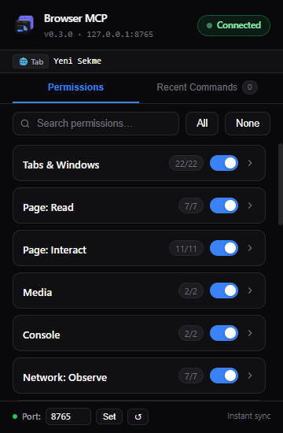
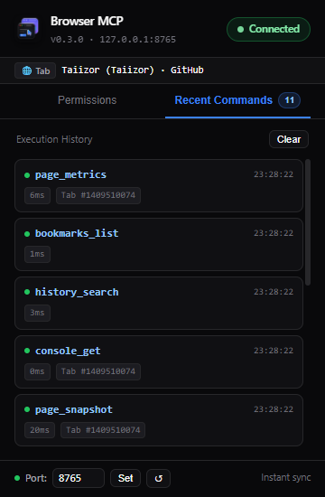

# Browser MCP — Full-Authority Browser Bridge (Chromium)

[](https://github.com/Taiizor/browser-mcp/actions/workflows/ci.yml)
[](LICENSE)
[](https://bun.sh)
[](extension/)

MCP server (`stdio`) + Chrome/Edge extension (`WebSocket`) with access to everything
in the browser: clicking, typing, search, tab & window management, tab groups, network intercept/throttle,
console, cookies, storage, offscreen clipboard, desktop notifications, session restore, screenshots, PDF, and CDP.

## Architecture

```text
AI (OpenCode / Claude / Gemini / Any MCP Client)
  │  stdio (MCP Tools, Resources, Prompts)
  ▼
mcp-server/ (Bun, WS bridge listening on 127.0.0.1:<port>)
  │  ws://127.0.0.1:8765 (configurable via CLI flag or env var)
  ▼
extension/ (Chrome MV3, WS client with alarms heartbeat & Origin security)
  ├── background.js → tabs, tab groups, cookies, history, webRequest, debugger (CDP), browsing data, notifications, alarms
  ├── offscreen.js  → clipboard read/write bridge
  └── content.js    → DOM snapshot, click, type, reactive page_wait, JS evaluate, console hook
```

## Quick Start

### 1. MCP server

Requirements: [Bun](https://bun.sh) >= 1.1.

```powershell
cd mcp-server
bun install
# Run server (default port 8765):
bun run src/index.ts
# Or with a custom port:
bun run src/index.ts --port 9000
```

### 2. Extension (Chrome / Edge)

1. `chrome://extensions` → enable **Developer Mode**.
2. **Load unpacked** → select the `extension/` folder.
3. Click the **Browser MCP** toolbar icon → you should see `Connected`.
4. Configure or switch ports instantly in the popup footer if needed.

### 3. MCP Client Configuration

The server runs over `stdio`, so any MCP-compatible client works. Use an **absolute path**
to `mcp-server/src/index.ts` and make sure `bun` is on your `PATH`.
(On Windows, use forward slashes or escaped backslashes in JSON.)
> **PATH tip:** GUI-launched clients (Claude Desktop, Cursor, Windsurf…) may not inherit
> your shell `PATH`. If the server fails to start, put the full path to `bun` in `command`
> (find it with `where bun` on Windows / `which bun` on macOS-Linux).

| Client | Config file |
|---|---|
| OpenCode | `opencode.json` |
| Claude Code | `.mcp.json` (project) or `claude mcp add` CLI |
| Claude Desktop | `claude_desktop_config.json` |
| Cursor | `.cursor/mcp.json` (project) or `~/.cursor/mcp.json` (global) |
| Windsurf | `~/.config/devin/mcp_config.json` (see note below) |
| VS Code (Copilot) | `.mcp.json` at workspace root (portable format) |
| Gemini CLI | `~/.gemini/settings.json` (global) or `.gemini/settings.json` (project), or `gemini mcp add` CLI |
| Antigravity | `~/.gemini/config/mcp_config.json` (global) or `.agents/mcp_config.json` (workspace) |

**OpenCode v2** (`opencode.json` / `opencode.jsonc`) — via CLI (recommended):

```powershell
opencode mcp add browser -- bun run <path-to-repo>/mcp-server/src/index.ts
```

or by hand:

```json
{
  "$schema": "https://opencode.ai/config.json",
  "mcp": {
    "servers": {
      "browser": {
        "type": "local",
        "command": ["bun", "run", "<path-to-repo>/mcp-server/src/index.ts"],
        "environment": {
          "BROWSER_MCP_PORT": "8765"
        }
      }
    }
  }
}
```

`environment` is optional — omit it to use the default port (`8765`). See [Custom Port Selection](#custom-port-selection).
Verify with `opencode mcp list` (should show `browser connected`).
Note: OpenCode v1 nests servers directly under `mcp` without the `servers` key.

**Claude Code** — via CLI (recommended):

```powershell
claude mcp add browser -- bun run <path-to-repo>/mcp-server/src/index.ts
```

(Add `--scope project` to write to `.mcp.json` instead of the default local scope.)

or via `.mcp.json`:

```json
{
  "mcpServers": {
    "browser": {
      "type": "stdio",
      "command": "bun",
      "args": ["run", "<path-to-repo>/mcp-server/src/index.ts"]
    }
  }
}
```

**Claude Desktop / Cursor / Windsurf / Gemini CLI / Antigravity** (`mcpServers` format):

```json
{
  "mcpServers": {
    "browser": {
      "command": "bun",
      "args": ["run", "<path-to-repo>/mcp-server/src/index.ts"]
    }
  }
}
```

File locations per client:
- **Claude Desktop:** `claude_desktop_config.json` (`%APPDATA%\Claude\` on Windows, `~/Library/Application Support/Claude/` on macOS, `~/.config/Claude/` on Linux) — restart the app after editing.
- **Cursor:** `.cursor/mcp.json` (project) or `~/.cursor/mcp.json` (global) — restart Cursor and enable the server under *Settings → Tools & MCP*. (Cursor's schema documents an optional `"type": "stdio"` field; the shape above works as-is.)
- **Windsurf:** `~/.config/devin/mcp_config.json` on macOS/Linux (`%APPDATA%\devin\mcp_config.json` on Windows), editable via *Cascade panel → ⋯ → Open MCP config file* (global only — no project-scope file). Older installs may still use the legacy `~/.codeium/windsurf/mcp_config.json` path.
- **Gemini CLI:** `~/.gemini/settings.json` (global) or `.gemini/settings.json` (project) — or via CLI:
  ```powershell
  gemini mcp add -s user browser bun run <path-to-repo>/mcp-server/src/index.ts
  ```
- **Antigravity:** `~/.gemini/config/mcp_config.json` (global) or `.agents/mcp_config.json` (workspace) — also editable via *Agent panel → ⋯ → MCP Servers → Manage MCP Servers → View raw config*. The same file is picked up by the Antigravity CLI (`agy`).

**VS Code** (portable `.mcp.json` at workspace root, recommended):

```json
{
  "mcpServers": {
    "browser": {
      "command": "bun",
      "args": ["run", "<path-to-repo>/mcp-server/src/index.ts"]
    }
  }
}
```

Alternatively, the legacy VS Code format (`.vscode/mcp.json`) uses a `servers` key with an explicit type:

```json
{
  "servers": {
    "browser": {
      "type": "stdio",
      "command": "bun",
      "args": ["run", "<path-to-repo>/mcp-server/src/index.ts"]
    }
  }
}
```

**Any other stdio-capable client:** command `bun`, args
`["run", "<path-to-repo>/mcp-server/src/index.ts"]`, optional env
`BROWSER_MCP_PORT` for a custom bridge port.

### Custom Port Selection

You can configure the WebSocket bridge port from **either** side:
- **CLI Flag:** `bun run src/index.ts --port 9000` or `-p 9000` or positional `bun run src/index.ts 9000`
- **Environment Variable:** `BROWSER_MCP_PORT=9000` or `PORT=9000`
- **Extension Popup:** Type the port in the popup footer and click **Set** (or press Enter). Click **↺** to reset to `8765`. Reconnection is instant without reloading the extension.

---

## Permissions & UI (Extension Popup)

The toolbar icon opens a zinc-dark panel:

| Permissions | Recent Commands (Audit Log) |
|---|---|
|  |  |
- **Live Connection Badge:** Real-time bridge status (`Connected` / `No server`).
- **Active Tab Bar:** Displays the currently focused tab title, URL, and Tab ID.
- **Search & Filter:** Instant search across all permissions and category names.
- **18 Categories:** Tabs, Page Read, Page Interact, Media, Console, Network Observe, Network Intercept, Downloads, Bookmarks, Cookies, Storage, Dialogs, Power, System, Trusted Input, Tab Groups, Clipboard, Notifications.
- **Tabbed Interface:** Switch between **Permissions** and **Recent Commands** effortlessly.
- **Recent AI Commands (Audit Log):** Live stream of up to 50 executed commands, durations, timestamps, and status for full transparency, with a one-click **Clear** action.
- **Master & Individual Switches:** Batch toggle or fine-grained control. Changes sync instantly via `chrome.storage.local`.

---

## Tools (111)

| Group | Tools |
|---|---|
| **Status & Lifecycle** | `browser_status`, `browser_launch`, `browser_close` |
| **Tabs & Windows** | `tab_list`, `tab_create`, `tab_duplicate`, `tab_close`, `tab_activate`, `tab_navigate`, `tab_reload`, `tab_back`, `tab_forward`, `tab_pin`, `tab_mute`, `window_list`, `window_create`, `window_focus` |
| **Tab Groups** | `tab_group_create`, `tab_group_list`, `tab_group_update`, `tab_group_ungroup` |
| **DOM Interaction** | `page_snapshot`, `page_html`, `page_text`, `dom_query`, `dom_click`, `dom_type`, `dom_fill`, `dom_select`, `dom_check`, `dom_hover`, `dom_focus`, `dom_scroll`, `dom_drag`, `keyboard_press`, `page_find`, `page_wait` |
| **Media & Screenshots** | `page_screenshot` (viewport, `fullPage` with layout metrics, or `selector` element shot), `page_pdf` |
| **Console & JS** | `js_evaluate`, `console_get`, `console_clear` |
| **Network Observe & Intercept** | `network_requests`, `network_clear`, `network_response_body`, `network_bodies`, `network_throttle`, `network_set_headers`, `har_export` |
| **Network Mocking** | `network_mock_start`, `network_mock_route`, `network_mock_list`, `network_mock_remove`, `network_mock_clear`, `network_mock_stop` |
| **Clipboard** | `clipboard_read`, `clipboard_write` (via offscreen bridge) |
| **Cookies & Sessions** | `cookies_list`, `cookies_get`, `cookies_set`, `cookies_delete`, `cookies_clear`, `cookies_export`, `cookies_import`, `sessions_recently_closed`, `sessions_restore`, `session_state_save`, `session_state_load` |
| **Storage & IndexedDB** | `storage_get`, `storage_set`, `history_search`, `history_delete`, `browsing_data_clear`, `idb_list`, `idb_stores`, `idb_read`, `idb_count`, `idb_put`, `idb_delete`, `idb_clear` |
| **Downloads & Bookmarks** | `downloads_list`, `downloads_pause`, `downloads_resume`, `downloads_cancel`, `downloads_erase`, `bookmarks_search`, `bookmarks_list`, `bookmarks_add`, `bookmarks_remove` |
| **Notifications & Dialogs** | `notification_create`, `notification_clear`, `dialog_policy`, `dialog_get`, `dialog_clear` |
| **Files & Frames** | `dom_upload` (CDP file upload into `<input type=file>`), `frame_list`, `frame_focus`, `frame_clear` |
| **Metrics & Emulation** | `page_axtree`, `page_metrics`, `permissions_grant`, `emulation_geolocation`, `emulation_geolocation_clear` |
| **Trusted Input & CDP** | `trusted_click`, `trusted_type`, `trusted_key`, `trusted_scroll`, `trusted_drag`, `cdp_send` |
| **Permission Controls** | `permissions_list`, `permissions_set` |

---

## MCP Resources

Read live state directly without tool invocation:
- `browser://status` — Real-time bridge connectivity, active port, buffered events count.
- `browser://tabs` — Live list of all open tabs across windows.
- `browser://console/recent` — Recent 50 console entries.
- `browser://network/recent` — Recent 50 network requests.

---

## MCP Prompts

Ready-to-use workflows for AI agents:
- `web_research` — Researches a specific topic on a target URL with structured extraction.
- `form_automation` — Identifies and populates form elements with given values before submission.
- `performance_audit` — Measures metrics, audits slow requests, and evaluates page speed.
- `accessibility_audit` — Inspects the accessibility tree, ARIA roles, and labels.

---

## Security & Reliability

- **Origin Validation:** The WebSocket server checks the `Origin` header on connection, rejecting requests originating from web pages (`http://`, `https://`) while allowing extension and local scripts.
- **Service Worker Keep-Alive:** Manifest V3 service worker lifecycle is protected with a `chrome.alarms` heartbeat (`mcp_heartbeat`), waking up the worker and auto-reconnecting if disconnected.
- **Reactive page_wait:** Uses `MutationObserver` to wait for elements, text, URLs (`url`, `urlPattern`), or document `readyState` without polling lag.
- The bridge listens on loopback only (`127.0.0.1`) — see [SECURITY.md](SECURITY.md) for the threat model and how to report vulnerabilities privately.

---

## Contributing

Contributions are welcome! Please read [CONTRIBUTING.md](CONTRIBUTING.md) and the
[Code of Conduct](CODE_OF_CONDUCT.md) first. Bug reports and feature requests use
issue templates; PRs should target the `develop` branch.

## License

[MIT](LICENSE) © 2026 Taiizor.
