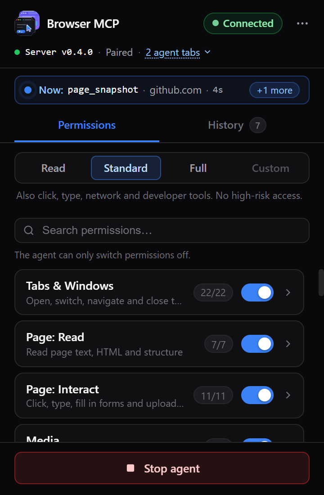
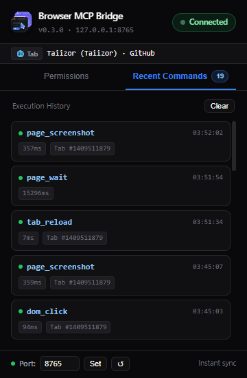

# Extension: popup and permissions

The extension (`extension/`, Chromium Manifest V3, Chrome/Edge/Brave/Opera 116+) executes every command. Its
popup is where the user decides what the agent may do. Installation: [installation.md](installation.md#extension).

- [Popup](#popup)
- [Permission categories](#permission-categories)
- [Permission rules](#permission-rules)
- [Agent tabs, dialogs and console capture](#agent-tabs-dialogs-and-console-capture)
- [Debugger sessions](#debugger-sessions)

## Popup

| Permissions | Recent Commands (Audit Log) |
|---|---|
|  |  |

- **Connection badge and pair bar:** `Connected`, `Connecting…`, `Action needed`, `Unverified server`,
  `Update needed`, `Rejected` or `No server`, with an explanation and the fix when something is wrong, a
  **Re-pair** button when the server asks to pair again, the server version once paired, and **Forget pairing**.
  Every state is explained in [pairing.md](pairing.md#popup-states). The pairing key itself is kept in the
  extension's own IndexedDB, out of reach of web pages and content scripts.
- **Version and port:** the header shows the extension version and `127.0.0.1:<port>` (hover for the
  extension id).
- **Active tab bar:** title, URL and id of the focused tab.
- **Search and filter** across all permissions and category names.
- **Permissions / Recent Commands tabs.** The audit log streams up to 50 executed commands with duration,
  time and status, with a one-click **Clear**.
- **Master and individual switches:** **All** / **None**, or per action. Changes apply at once and are stored in
  `chrome.storage.local`. The background worker answers popup operations only for the extension's own pages
  (never for content scripts or web pages) and, while it runs, reverts a storage write that would turn a
  switch back on.
- **Port footer:** type a port and click **Set** (or press Enter); **↺** resets it to `8765`. The extension
  reconnects at once.
- **Language:** English, Türkçe, Español, Deutsch, Français, Português, Italiano, Русский, 日本語, 한국어, or **Auto**
  (browser language).

## Permission categories

21 categories; each tool's toolset ([toolsets.md](toolsets.md)) is the category of the action it runs.

| Category | Actions |
|---|---|
| Tabs & Windows | tabs, windows, frames, tab groups, `browser_close` |
| Page: Read | `page_snapshot`, `page_html`, `page_text`, `dom_query`, `page_find`, `page_wait`, `page_axtree` |
| Page: Interact | `dom_*` input, `dom_upload`, `keyboard_press` |
| Media | `page_screenshot`, `page_pdf`, tab audio recording |
| Console | `console_get`, `console_clear` |
| Network: Observe | requests, response bodies, HAR export, throttling, extra headers |
| Network: Intercept | `network_mock_*` |
| Downloads | `downloads_*` |
| Bookmarks | `bookmarks_*` |
| Cookies | `cookies_*` |
| Storage | `storage_get` / `storage_set`, `idb_*` |
| Sessions & State | recently closed sessions, `session_state_save` / `session_state_load` |
| Dialogs | `dialog_policy`, `dialog_get`, `dialog_clear` |
| Power (arbitrary code) | `js_evaluate`, `cdp_send` |
| Trusted Input (CDP) | `trusted_click`, `trusted_type`, `trusted_key`, `trusted_scroll`, `trusted_drag` |
| Clipboard | `clipboard_read`, `clipboard_write` |
| Browsing Data | `browsing_data_clear` |
| Notifications | `notification_create`, `notification_clear` |
| Emulation | `emulation_geolocation`, `emulation_geolocation_clear`, `emulation_viewport`, `emulation_media`, `emulation_cpu`, `emulation_reset` |
| Performance | `page_metrics`, `perf_web_vitals`, `perf_trace_start`, `perf_trace_stop` (and its internal `perf_trace_chunk`) |
| System | `permissions_grant`, `history_search`, `history_delete` |

## Permission rules

- **The agent can only disable.** `permissions_set` turns an action off (self-restriction, synced to the
  popup); `enabled: true` is rejected. Only the user can turn an action back on, in the popup.
- **Allow-list gate.** The extension runs only actions it knows from its catalog; anything else fails with
  `Unknown command: <action>`.
- **New actions respect a switched-off category.** An action added by an update starts disabled when every
  action of its category that existed before was disabled, so a category the user turned off stays off.
- **Composite requirements.** Some tools reach data guarded by other switches, so those must be on too:
  `session_state_save` needs `cookies_list` + `storage_get`; `session_state_load` needs `cookies_set` +
  `storage_set`; `har_export`, `network_bodies` and `network_response_body` need `network_requests`;
  `cookies_export` needs `cookies_list`; `cookies_import` needs `cookies_set`. The error names the missing
  switch. `perf_trace_start` also needs `page_screenshot` when it would record page content:
  `screenshots: true`, or an included category pattern that matches `disabled-by-default-devtools.screenshot`
  or a paint-data category (`disabled-by-default-devtools.timeline.picture`, `.timeline.layers`,
  `.timeline.paint`, `disabled-by-default-cc.debug.*`, `disabled-by-default-skia*`), whether by name, through a
  wildcard (such as `disabled-by-default-*`; a bare `*` does not count) or as any pattern naming screenshots,
  pictures, display items, layers or skia. This depends on the arguments, so the tool stays listed and the call
  is refused before tracing starts.
- `tab_close` on the last tab of the last window quits the browser and therefore also needs `browser_close`.
  `browser_close` (graceful or `force`) honours its switch, using the last known state when the extension is
  silent.
- **Switches gate capture.** With `console_get`, `network_requests` or `dialog_get` off, nothing of that kind is
  recorded, and the server's local fallback buffers are cleared and refuse to answer.
- **Switching off ends running sessions.** Disabling an action that controls a debugger session (mocking,
  throttling, extra headers, geolocation, emulation, tracing) tears that session down at once.
- **Hidden from the agent.** Tools whose actions are off are removed from the MCP tool list; calling one anyway
  returns an error that tells the agent only the user can switch it back on
  ([toolsets.md](toolsets.md#tools-hidden-by-the-popup-switches)).
- **Power is unbounded.** `js_evaluate` and `cdp_send` run arbitrary code in the page and can reach anything the
  other categories guard. Turn **Power** off when the switches must be a hard boundary.
- `permissions_grant` takes an exact `http(s)` origin (`https://example.com`, no wildcards, paths or trailing
  slash) and a setting of `allow`, `block` or `ask`.

## Agent tabs, dialogs and console capture

Console and dialog hooks run only in the main frame of tabs the agent works in, and only while the bridge is
paired:

- **Agent tabs** are tabs the agent created (`tab_create`, `tab_duplicate`, `window_create`) or targeted with an
  explicit `tabId`. They get console capture and the dialog hook that applies `dialog_policy`.
- **Fallback tabs:** a command without `tabId` acts on the focused tab, but the user's own tab must not become a
  permanent agent tab. It gets console capture only, never automatic dialog answers, and loses even that on a
  main-frame cross-origin navigation the agent did not cause, when it closes, or when the bridge has been down
  for 15 s. Targeting it later with an explicit `tabId` makes it a full agent tab.
- Messages logged before a tab became an agent tab are not captured.
- `dialog_policy` (auto-accept, prompt text, `blockUnload`) applies to agent tabs only, survives service-worker
  restarts, and `blockUnload` can be switched on and off live.
- If the bridge stays disconnected for 15 s, agent tabs get native dialogs back and console capture stops until
  it reconnects and pairs again.

## Debugger sessions

Network mocking and spying, throttling, extra headers, geolocation, viewport / media / CPU emulation and
performance traces keep the Chrome debugger attached to the tab, so Chrome shows its "is debugging this
browser" bar. Parallel CDP tools on one tab share one attach; cancelling the bar ends the tab's sessions.

Every such session is torn down (CDP state cleared, debugger released):

- when the action that controls it is switched off in the popup;
- when the bridge has been disconnected for more than 30 s;
- when the debugger is detached or the tab closes.

A session is never re-established on its own after a service-worker restart without a connected, paired
bridge. Mock routes keep applying during the 30 s grace period, but spy recording stops as soon as the bridge
is unpaired.

The network-idle condition of `page_wait` counts in-flight requests per tab through `webRequest`, keeping only
request ids and start times (no URLs), independently of network capture and its switch.
