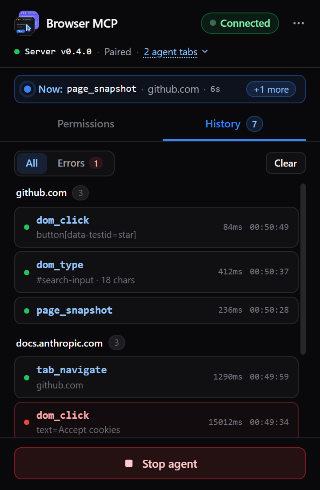
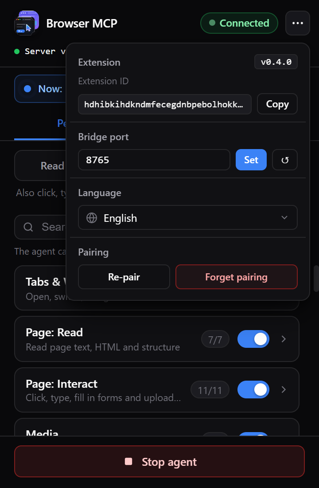
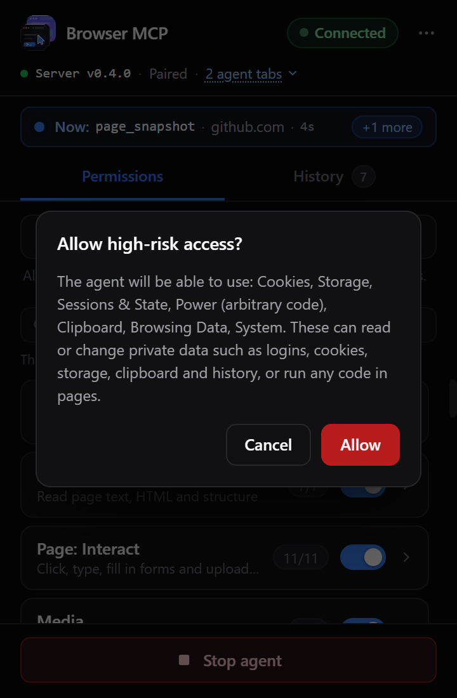
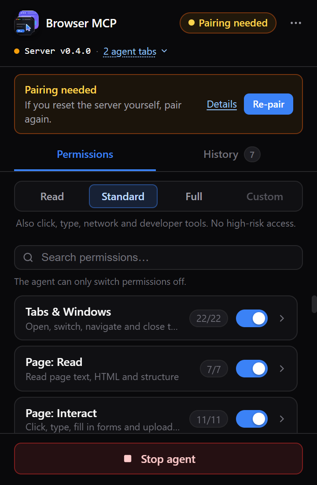
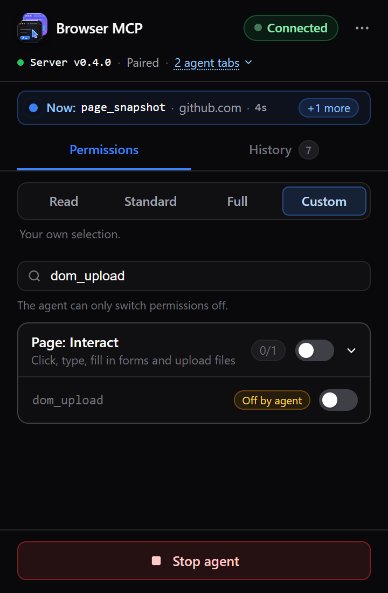

# Extension: popup and permissions

The extension (`extension/`, Chromium Manifest V3, Chrome/Edge/Brave/Opera 116+) executes every command. Its
popup is where the user decides what the agent may do. Installation: [installation.md](installation.md#extension).

- [Popup](#popup): [profiles](#access-profiles), [categories](#categories-and-switches), [history](#history),
  [Stop agent](#stop-agent), [settings menu](#settings-menu)
- [Permission categories](#permission-categories)
- [Permission rules](#permission-rules)
- [Agent tabs, dialogs and console capture](#agent-tabs-dialogs-and-console-capture)
- [Debugger sessions](#debugger-sessions)

## Popup

| Permissions | History | Settings menu |
|---|---|---|
|  |  |  |
| **High-risk confirmation** | **Pairing notice** | **Switched off by the agent** |
|  |  |  |

The popup answers two questions at a glance: what the agent can reach, and what it is doing right now. While it
is open it refreshes the status every second and the history every 1.5 seconds. From top to bottom:

- **Header:** the connection badge (`Connected`, `Connecting…`, `Pairing needed`, `Unknown server`,
  `Update needed`, `Rejected`, `Disconnected` or `No server`) and the **⋯** button that opens the [settings menu](#settings-menu).
  Every state is explained in [pairing.md](pairing.md#popup-states).
- **Status line** under the header: `Server <version> · <pairing> · <agent tabs>`. The pairing part reads
  `Paired` (hover for the full text), `Verifying the MCP server…` or `Not paired yet`, and is left out when
  the badge and a notice already say what is wrong. The agent tab count (`No agent tabs`, `1 agent tab`, `<n> agent tabs`) opens a list of the
  tabs the agent works in (title and site, up to 20); click one to bring its tab and window to the front. Tabs
  used only as the active-tab fallback are not listed ([agent tabs](#agent-tabs-dialogs-and-console-capture)).
- **Problem notice:** when the connection needs attention, a short title and one sentence (for example
  **Pairing is closed**: "Start the server once with --pair."), at most one button (**Re-pair** when pairing again
  fixes it, **Forget pairing** when the server rejected this browser's key, **Copy ID** when the server does not
  recognize the extension) and a **Details** link that opens the
  matching section of [pairing.md](pairing.md#popup-states) with the full fix.
- **Live activity strip**, only while commands run: a pulsing dot and `Now: <action> · <site> · <seconds>s` for
  the newest command, ticking every second, plus `+<n> more` when several run at once.
- **Permissions** and **History** tabs (the History tab shows the number of entries), then the
  [Stop agent](#stop-agent) button at the bottom.

### Access profiles

The Permissions tab starts with four profiles. The highlighted one is derived from the current switches, so it
always shows what the agent can actually reach:

| Profile | Enables |
|---|---|
| **Read** | `tabs_list`, `tab_create`, `tab_activate`, `tab_navigate`, `tab_reload`, `tab_back`, `tab_forward`, `window_list`, `frame_list`, `frame_focus`, `frame_clear`, `tab_group_list`; every **Page: Read** action; `page_screenshot`; `console_get`; `page_metrics` and `perf_web_vitals`. Everything else is off: nothing is clicked or typed. |
| **Standard** | Every action of every category that is not high risk; the high-risk categories are off. |
| **Full** | Everything, including the high-risk categories. |
| **Custom** | Any other selection. It only shows that the switches match no profile and cannot be clicked. |

Clicking a profile changes only the switches that differ from it, in one write.

**High risk:** Power (arbitrary code), Cookies, Storage, Sessions & State, Clipboard, Browsing Data and System
carry a **High risk** badge. Any change that would switch on a disabled action of one of them (a profile, a
category switch or a single switch) first asks **Allow high-risk access?** and names the categories; **Cancel**
leaves the switches as they were. Switching off never asks.

### Categories and switches

- **Search** filters by action name, category name and category description, and expands the matching
  categories.
- **Category cards** are collapsed by default. The head shows the category name, the **High risk** badge where it
  applies, a one-line description, how many actions are on (`on/total`), a switch for the whole category and a
  chevron that expands it into one switch per action.
- **Off by agent:** an action the agent switched off itself (`permissions_set`) carries this badge. It goes away
  when you change that switch yourself, or after **Stop agent**. The badge is only a reminder: it never switches
  anything back on.
- Changes apply at once and are stored in `chrome.storage.local`. The background worker answers popup operations
  only for the extension's own pages (never for content scripts or web pages) and, while it runs, reverts a
  storage write that would turn a switch back on.

### History

The History tab keeps the last 50 commands, in the extension's memory only (lost when the browser or the
extension's background worker restarts):

- grouped by the site of the tab the command acted on (**No page** when there was none), the group with the
  newest command first, each with its number of commands;
- one row per command: a status dot, the action, a short summary, the duration and the time. Depending on the
  command the summary is the selector, the number of characters typed or evaluated (never the text or code),
  the number of fields or files, the target site or cookie domain, a key name such as `Enter` or the CDP
  method. The summary never contains typed text, values, code or file paths;
- click a row for its details: the full error text, the tab id and the summary. The error text of a failed
  command is kept as the extension reported it, so it can quote a page URL, a value the command was given (such
  as the option a `dom_select` did not find) or a JavaScript exception message;
- **All** / **Errors** filter the list; **Clear** empties it.

### Stop agent

**Stop agent** at the bottom of the popup switches every permission off at once and cancels the commands that are
running (they answer `cancelled`); debugger sessions end as with any switch turned off. It does not ask for
confirmation and shows **Everything is off** when done. Switch back on what you need, or pick a profile.

### Settings menu

The **⋯** button in the header opens the menu; Escape or a click outside closes it.

- **Extension:** the extension version and id, with **Copy**.
- **Bridge port:** type a port and click **Set** (or press Enter); **↺** resets it to `8765`. The extension
  reconnects at once.
- **Language:** English, Türkçe, Español, Deutsch, Français, Português, Italiano, Русский, 日本語, 한국어, or **Auto**
  (browser language).
- **Pairing:** **Re-pair** accepts the server's next pairing offer for 2 minutes and reconnects
  ([pairing.md](pairing.md#re-pair)). **Forget pairing** asks for confirmation, then deletes this browser's
  pairing key; the agent cannot connect again until a server offers pairing (first setup, or a server started
  with `--pair`; see [pairing.md](pairing.md#forget-pairing)). The pairing key itself is kept in the extension's
  own IndexedDB, out of reach of web pages and content scripts.

## Permission categories

21 categories; each tool's toolset ([toolsets.md](toolsets.md)) is the category of the action it runs.

| Category | Actions |
|---|---|
| Tabs & Windows | tabs, windows, frames, tab groups, `browser_close` |
| Page: Read | `page_snapshot`, `page_html`, `page_text`, `dom_query`, `page_find`, `page_wait`, `page_axtree` |
| Page: Interact | `dom_*` input, `dom_upload`, `keyboard_press` |
| Media | `page_screenshot`, `page_pdf`, tab audio recording |
| Console | `console_get`, `console_clear` |
| Network: Observe | requests, response bodies, HAR export, throttling, extra headers |
| Network: Intercept | `network_mock_*` |
| Downloads | `downloads_*` |
| Bookmarks | `bookmarks_*` |
| Cookies | `cookies_*` |
| Storage | `storage_get` / `storage_set`, `idb_*` |
| Sessions & State | recently closed sessions, `session_state_save` / `session_state_load` |
| Dialogs | `dialog_policy`, `dialog_get`, `dialog_clear` |
| Power (arbitrary code) | `js_evaluate`, `cdp_send` |
| Trusted Input (CDP) | `trusted_click`, `trusted_type`, `trusted_key`, `trusted_scroll`, `trusted_drag` |
| Clipboard | `clipboard_read`, `clipboard_write` |
| Browsing Data | `browsing_data_clear` |
| Notifications | `notification_create`, `notification_clear` |
| Emulation | `emulation_geolocation`, `emulation_geolocation_clear`, `emulation_viewport`, `emulation_media`, `emulation_cpu`, `emulation_reset` |
| Performance | `page_metrics`, `perf_web_vitals`, `perf_trace_start`, `perf_trace_stop` (and its internal `perf_trace_chunk`) |
| System | `permissions_grant`, `history_search`, `history_delete` |

## Permission rules

- **The agent can only disable.** `permissions_set` turns an action off (self-restriction, synced to the
  popup, where it is marked **Off by agent**); `enabled: true` is rejected. Only the user can turn an action
  back on, in the popup.
- **Allow-list gate.** The extension runs only actions it knows from its catalog; anything else fails with
  `Unknown command: <action>`.
- **New actions respect a switched-off category.** An action added by an update starts disabled when every
  action of its category that existed before was disabled, so a category the user turned off stays off.
- **Composite requirements.** Some tools reach data guarded by other switches, so those must be on too:
  `session_state_save` needs `cookies_list` + `storage_get`; `session_state_load` needs `cookies_set` +
  `storage_set`; `har_export`, `network_bodies` and `network_response_body` need `network_requests`;
  `cookies_export` needs `cookies_list`; `cookies_import` needs `cookies_set`. The error names the missing
  switch. `perf_trace_start` also needs `page_screenshot` when it would record page content:
  `screenshots: true`, or an included category pattern that matches `disabled-by-default-devtools.screenshot`
  or a paint-data category (`disabled-by-default-devtools.timeline.picture`, `.timeline.layers`,
  `.timeline.paint`, `disabled-by-default-cc.debug.*`, `disabled-by-default-skia*`), whether by name, through a
  wildcard (such as `disabled-by-default-*`; a bare `*` does not count) or as any pattern naming screenshots,
  pictures, display items, layers or skia. This depends on the arguments, so the tool stays listed and the call
  is refused before tracing starts.
- `tab_close` on the last tab of the last window quits the browser and therefore also needs `browser_close`.
  `browser_close` (graceful or `force`) honours its switch, using the last known state when the extension is
  silent.
- **Switches gate capture.** With `console_get`, `network_requests` or `dialog_get` off, nothing of that kind is
  recorded, and the server's local fallback buffers are cleared and refuse to answer.
- **Switching off ends running sessions.** Disabling an action that controls a debugger session (mocking,
  throttling, extra headers, geolocation, emulation, tracing) tears that session down at once.
- **Hidden from the agent.** Tools whose actions are off are removed from the MCP tool list; calling one anyway
  returns an error that tells the agent only the user can switch it back on
  ([toolsets.md](toolsets.md#tools-hidden-by-the-popup-switches)).
- **Power is unbounded.** `js_evaluate` and `cdp_send` run arbitrary code in the page and can reach anything the
  other categories guard. Turn **Power** off when the switches must be a hard boundary.
- `permissions_grant` takes an exact `http(s)` origin (`https://example.com`, no wildcards, paths or trailing
  slash) and a setting of `allow`, `block` or `ask`.

## Agent tabs, dialogs and console capture

Console and dialog hooks run only in the main frame of tabs the agent works in, and only while the bridge is
paired:

- **Agent tabs** are tabs the agent created (`tab_create`, `tab_duplicate`, `window_create`) or targeted with an
  explicit `tabId`. They get console capture and the dialog hook that applies `dialog_policy`.
- **Fallback tabs:** a command without `tabId` acts on the focused tab, but the user's own tab must not become a
  permanent agent tab. It gets console capture only, never automatic dialog answers, and loses even that on a
  main-frame cross-origin navigation the agent did not cause, when it closes, or when the bridge has been down
  for 15 s. Targeting it later with an explicit `tabId` makes it a full agent tab.
- Messages logged before a tab became an agent tab are not captured.
- `dialog_policy` (auto-accept, prompt text, `blockUnload`) applies to agent tabs only, survives service-worker
  restarts, and `blockUnload` can be switched on and off live.
- If the bridge stays disconnected for 15 s, agent tabs get native dialogs back and console capture stops until
  it reconnects and pairs again.

## Debugger sessions

Network mocking and spying, throttling, extra headers, geolocation, viewport / media / CPU emulation and
performance traces keep the Chrome debugger attached to the tab, so Chrome shows its "is debugging this
browser" bar. Parallel CDP tools on one tab share one attach; cancelling the bar ends the tab's sessions.

Every such session is torn down (CDP state cleared, debugger released):

- when the action that controls it is switched off in the popup;
- when the bridge has been disconnected for more than 30 s;
- when the debugger is detached or the tab closes.

A session is never re-established on its own after a service-worker restart without a connected, paired
bridge. Mock routes keep applying during the 30 s grace period, but spy recording stops as soon as the bridge
is unpaired.

The network-idle condition of `page_wait` counts in-flight requests per tab through `webRequest`, keeping only
request ids and start times (no URLs), independently of network capture and its switch.
